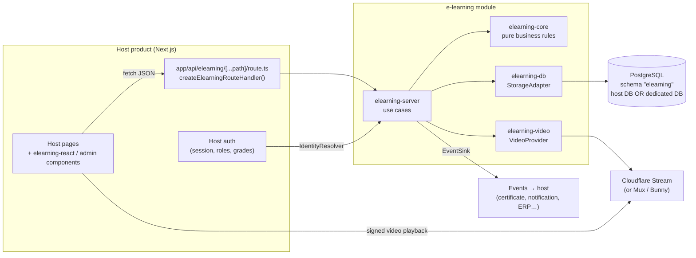

# 02 — Architecture

## Principles

1. **The core is framework-agnostic.** Business rules (progress, video coverage, grading, access) are pure TypeScript functions, testable without a database or a server.
2. **Ports and adapters.** Everything that varies between host products goes through an interface: storage, video provider, identity, events, file uploads.
3. **The server is the source of truth.** The client renders and sends signals. Only the server decides that a lesson is completed or a quiz is passed.
4. **Web standards.** Server handlers take a `Request` and return a `Response` (Web Fetch API). They mount in the Next.js App Router, and also in Hono, Remix or a Worker.
5. **The host stays in control.** It provides identity, roles, the database and the theme. The module never creates users or sessions.

## Monorepo

pnpm workspaces + Turborepo. Each package is published separately on npm under the `@bebranded` scope, which BeBranded already owns.

```
e-learning-by-BeBranded/
├── packages/
│   ├── core/          @bebranded/elearning-core
│   ├── db/            @bebranded/elearning-db
│   ├── server/        @bebranded/elearning-server
│   ├── video/         @bebranded/elearning-video
│   ├── editor/        @bebranded/elearning-editor
│   ├── react/         @bebranded/elearning-react
│   ├── admin/         @bebranded/elearning-admin
│   └── next/          @bebranded/elearning-next
├── apps/
│   ├── demo/          Demo Next.js app (fictional host product)
│   └── docs/          Public documentation
└── docs/specifications/
```

### Package responsibilities

| Package | Contents | Depends on |
|---------|----------|------------|
| **core** | Domain types, validation schemas (Zod), pure business rules: progress computation, video segment merging, quiz grading, access-rule evaluation, rich-content validation. Port interfaces (`StorageAdapter`, `VideoProvider`, `IdentityResolver`, `EventSink`, `FileStorage`). | nothing (except Zod) |
| **db** | Versioned PostgreSQL migrations, `StorageAdapter` implementation (Kysely on Postgres, Supabase-compatible), optional RLS policies, `elearning migrate` CLI. | core |
| **server** | Framework-agnostic HTTP handlers (learner API and admin API), use-case orchestration, event emission. | core |
| **video** | `VideoProvider` adapters: Cloudflare Stream (default), Mux, Bunny Stream. Direct upload, signed URLs, encoding webhooks. | core |
| **editor** | BlockNote integration: the module's block schema (standard blocks plus custom blocks such as callout, video embed and quiz questions), the authoring component, and server-side rendering of lesson content to HTML. | core |
| **react** | Learner components: `<CourseCatalog>`, `<CoursePage>`, `<LessonPlayer>`, `<LessonContent>`, `<VideoPlayer>`, `<Quiz>`, `<ProgressBar>`. `<ElearningProvider>` (API client, theme, i18n). | core |
| **admin** | Back-office components: content tree with drag & drop, lesson editor (from `editor`), quiz editor, access-rule management, learner tracking dashboard. | core, editor, react |
| **next** | Turnkey Next.js integration: `createElearningRouteHandler()`, Server Component helpers. A thin layer over `server`. | server |

A Next.js host product usually installs `elearning-next`, `elearning-db`, `elearning-video` and `elearning-react`, plus `elearning-admin` if it has a back-office. Learner pages never load the editor bundle.

## Overview



## Main flows

### Authoring a lesson (Notion-like)

1. The admin opens a lesson in the back-office. `<LessonEditor>` loads BlockNote with the module's block schema.
2. The author writes as in Notion: `/` opens the block menu (headings, lists, toggles, callouts, images, code, tables, video embed…).
3. Images and files are uploaded through the host-provided `FileStorage` port. BlockNote's `uploadFile` hook is wired to it.
4. On save, the editor sends the BlockNote JSON document. The server **validates it against the block schema** (allowed block types, allowed URL protocols, size limits) before storing it.

### Reading a text lesson

1. The server validates the stored document again and renders it to HTML with `renderLessonHtml` (`@bebranded/elearning-editor/server`): a pure string renderer that escapes every text, followed by `sanitize-html` as defense in depth (see D11).
2. The learner page ships no editor JavaScript, only the HTML and the module's content styles (themed with the `--el-*` tokens).

### Watching a video lesson

1. `<LessonPlayer>` calls `GET /lessons/:id`.
2. The server resolves the learner through `IdentityResolver`, checks access (audience rules) and returns the lesson with a **short-lived signed playback token**.
3. `<VideoPlayer>` plays the video from the provider and tracks the intervals that were actually watched.
4. Every 15 s, on pause and on page exit (`sendBeacon`), the client sends `POST /lessons/:id/video-progress` with the new intervals.
5. The server checks that the intervals are plausible, merges them and recomputes coverage. When coverage reaches the threshold, it sets the lesson to `completed` and emits `lesson.completed`.

Details in [06 — Video](06-video.md).

### Taking a quiz

1. `GET /quizzes/:id` returns the SurveyJS JSON **with the correct answers stripped out**.
2. The learner answers. `POST /quizzes/:id/attempts` sends the raw answers.
3. The server checks eligibility (remaining attempts, cooldown), grades with the full model, stores the attempt and returns the score. It only returns corrections if the quiz is configured to show them.

Details in [07 — Quizzes](07-quizzes.md).

## Technical decisions

| # | Decision | Alternatives considered | Rationale |
|---|----------|-------------------------|-----------|
| D1 | **Multi-package monorepo** rather than a single package | Single package, copy-paste per project | The host only ships what it uses (no editor dependencies without admin). Coordinated versioning with Changesets. |
| D2 | **PostgreSQL** as the only v1 storage target, in a dedicated `elearning` schema | Multi-DB ORM, Supabase only | Our products run on Postgres / Supabase. A dedicated schema avoids name collisions in the host database. The `StorageAdapter` interface leaves room for other databases. |
| D3 | **Kysely** for data access, raw SQL migrations | Prisma, Drizzle, Supabase client | Kysely generates nothing on the host side, works with any Postgres connection (host pool, Supabase, Neon) and coexists with the host's ORM. Raw SQL migrations stay readable and replayable. |
| D4 | **Web `Request` / `Response` handlers** | Server Actions only, tRPC | Portable outside Next.js, testable without a framework. Server Actions remain possible through `elearning-next`. |
| D5 | **SurveyJS Form Library (MIT)** to render quizzes | Custom quiz engine, Typeform | Mature, accessible engine with many question types. **SurveyJS Creator is not MIT** (commercial license), so we do not use it: our own quiz editor produces SurveyJS JSON (see D7). |
| D6 | **Cloudflare Stream** by default, behind a `VideoProvider` interface | YouTube / Vimeo, raw files on S3 | Signed URLs, adaptive streaming, predictable cost, and BeBranded already uses Cloudflare. YouTube and Vimeo allow neither reliable access control nor fine-grained tracking. |
| D7 | **BlockNote** as the content editor, documents stored as **BlockNote JSON** | Tiptap alone, Markdown, Lexical, Editor.js | Notion-like UX out of the box (slash menu, drag handles, nested blocks), which authors already know. Built on ProseMirror / Tiptap, with a typed document model that can be validated server-side and custom blocks for our needs. The quiz editor reuses it: each question is a custom block, converted to SurveyJS JSON on save. The core packages are **MPL-2.0**, compatible with MIT distribution when used unmodified. The `@blocknote/xl-*` packages (GPL-3.0 or commercial) are **excluded** (see [08 — Licensing](08-non-functional-requirements.md#licensing)). |
| D8 | **Theming through CSS custom properties** (`--el-*`), no imposed CSS framework | Tailwind preset, styled-components | Works with any host CSS stack. An optional Tailwind preset can map the tokens. |
| D9 | **Identity provided by the host** through `IdentityResolver` | Built-in auth, mandatory Supabase Auth | Every product already has auth. The module only stores an opaque `learner_id`. |
| D11 | **Our own HTML renderer for lesson content**, from the validated document | `@blocknote/server-util` | server-util runs BlockNote in jsdom with React, cannot render toggle blocks under Node (they read `localStorage`, which jsdom refuses without an origin), and does not run on edge runtimes. Our renderer is pure, small, runs anywhere, emits only markup we allowlist, and is the HTML renderer the PDF export needs anyway ([10 — Editor extensions](10-editor-extensions.md)). |
| D10 | **Multi-column layout, PDF export and Word export built in-house under MIT**, in clean room | `@blocknote/xl-*` packages (GPL-3.0 or commercial) | GPL would contaminate host products. A commercial license would not cover the people who install our MIT packages. Details and clean-room rules in [10 — Editor extensions](10-editor-extensions.md). |

## Versioning and distribution

- **Strict semver**, one version per package, coordinated with Changesets.
  - *patch*: fixes, no migration.
  - *minor*: new features and **additive** migrations (new tables or nullable columns).
  - *major*: API changes or non-backward-compatible migrations, with a migration guide.
- **Migrations ship in `elearning-db`.** The host runs `pnpm elearning migrate` in CI or at deploy time. An `elearning.schema_migrations` table records the applied migrations.
- At startup, the module checks that the schema version matches the code version and fails with an explicit error otherwise.
- Host products receive updates through Renovate or Dependabot.
- npm publishing runs from GitHub Actions with **npm provenance** and **trusted publishing** (OIDC, no long-lived npm token stored in the repository).
