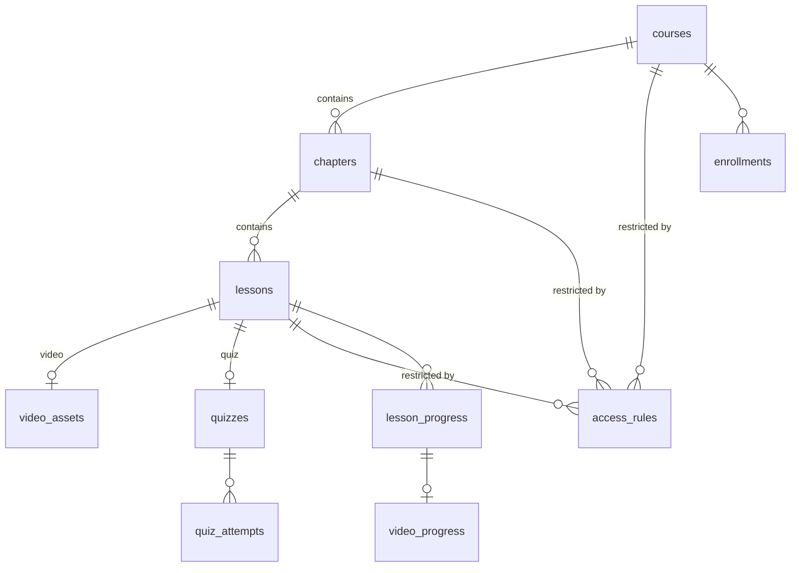

# 03 — Data model

All tables live in a **dedicated PostgreSQL schema**, `elearning` by default (configurable). This holds whether the schema sits in the host product's database or in a dedicated one (see [04 — Integration](04-integration.md#2-data-modes)).

## Conventions

- `uuid` primary keys (`gen_random_uuid()`).
- `created_at` / `updated_at` as `timestamptz` on every table.
- **`tenant_id text null`** on every content and progress table. It serves multi-company hosts (an ERP serving several companies). It stays `null` for single-tenant hosts.
- **`learner_id text not null`** is the opaque identifier of the user in the host product, unique across the host's tenants (one id per person, as in the host's users table). There is **no foreign key** to the host's users table, so a dedicated database works. In embedded mode, the host may add an FK if it wants to.
- Ordering positions (`position`) are integers. Reordering runs in a single transaction.

## Schema

### Content

**`courses`**

| Column | Type | Notes |
|--------|------|-------|
| id | uuid PK | |
| tenant_id | text null | |
| slug | text | unique per tenant |
| title | text | |
| summary | text null | |
| cover_image_url | text null | |
| status | enum `draft` \| `published` \| `archived` | |
| published_at | timestamptz null | |
| completion_rule | jsonb | e.g. `{ "type": "all_required_lessons" }` |
| enrollment_mode | enum `self` \| `assignment_only` | whether learners can enroll themselves (see [05 — Permissions](05-permissions.md#enrollment-and-assignment)) |
| locale | text | `en`, `fr`… |
| metadata | jsonb | free-form field for the host |

**`chapters`**: `id`, `course_id` FK, `title`, `position`, `status`.

**`lessons`**

| Column | Type | Notes |
|--------|------|-------|
| id | uuid PK | |
| chapter_id | uuid FK | |
| type | enum `text` \| `video` \| `quiz` | |
| title | text | |
| position | int | |
| status | enum `draft` \| `published` | |
| is_required | bool | counts toward course completion (default `true`) |
| estimated_minutes | int null | |
| content | jsonb null | **BlockNote document** (array of blocks). Main body for `text` lessons, accompanying notes for `video` and `quiz`. Validated against the module's block schema before writing. |
| content_schema_version | int | version of the block schema used, for future content migrations |
| settings | jsonb | per type. Video: `{ "completionThreshold": 0.95, "allowSeeking": false, "maxPlaybackRate": 2 }`. Quiz: `{ "passingScore": 0.8, "maxAttempts": 3, "cooldownMinutes": 60, "timeLimitMinutes": null, "shuffleQuestions": true, "shuffleOptions": true, "showCorrection": "after_pass" }` ([07 — Quizzes](07-quizzes.md#per-lesson-options)) |

**`video_assets`**

| Column | Type | Notes |
|--------|------|-------|
| id | uuid PK | |
| lesson_id | uuid FK unique | |
| tenant_id | text null | copy of the lesson tenant |
| provider | text | `cloudflare-stream`, `mux`, `bunny`. Unique with `provider_asset_id` |
| provider_asset_id | text | |
| status | enum `uploading` \| `processing` \| `ready` \| `error` | updated by webhook |
| duration_seconds | numeric null | **source of truth** for coverage. Comes from the provider, never from the client. |
| thumbnail_url | text null | |
| captions | jsonb | subtitle tracks `[{ lang, url }]` |

**`quizzes`**

| Column | Type | Notes |
|--------|------|-------|
| id | uuid PK | |
| lesson_id | uuid FK unique | the lesson must be of type `quiz` |
| tenant_id | text null | copy of the lesson tenant |
| editor_document | jsonb | BlockNote document of the quiz editor, the source of `definition` |
| definition | jsonb | **Graded definition** derived on save (`editorDocumentToQuiz`), correct answers included. Never sent to the client. |
| version | text | SHA-256 of the definition |
| question_count | int | 1 to 200 |

The quiz options (passing score, attempts, cooldown, time limit, shuffling, corrections) live in the lesson's `settings`.

**`files`**: `id`, `tenant_id`, `storage_key`, `mime_type`, `size_bytes`, `uploaded_by`, `created_at`. Images and attachments uploaded from the editor are stored through the host's `FileStorage` port. Only the key is stored here.

### Access

**`access_rules`**: see [05 — Permissions](05-permissions.md).

| Column | Type | Notes |
|--------|------|-------|
| id | uuid PK | |
| tenant_id | text null | |
| target_type | enum `course` \| `chapter` \| `lesson` | |
| target_id | uuid | |
| effect | enum `allow` \| `deny` | |
| audience_type | enum `everyone` \| `role` \| `grade_min` \| `learner` | |
| audience_value | text null | role name, grade level or `learner_id`. In code, the pair is one typed `audience` value (`{ type: "role", role }`…) |

### Progress

**`enrollments`**: `id`, `tenant_id`, `course_id`, `learner_id`, `source` (`self` \| `assigned` \| `auto`), `assigned_by` null, `due_at` null, `started_at` null (set when the first lesson starts), `completed_at` null, `progress` numeric (0–1, denormalized). Unique on (`course_id`, `learner_id`). `tenant_id` is the learner's tenant, which can differ from a shared course's.

**`lesson_progress`**

| Column | Type | Notes |
|--------|------|-------|
| id | uuid PK | |
| lesson_id | uuid FK | |
| learner_id | text | |
| status | enum `not_started` \| `in_progress` \| `completed` | |
| started_at / completed_at | timestamptz | |
| | | unique (`lesson_id`, `learner_id`) |

**`video_progress`**

| Column | Type | Notes |
|--------|------|-------|
| lesson_progress_id | uuid PK/FK | |
| watched_ranges | jsonb | merged intervals in seconds, e.g. `[[0, 42.5], [60, 120]]` |
| watched_seconds | numeric | length of the union, denormalized |
| coverage | numeric | `watched_seconds / duration_seconds` |
| last_position | numeric | to resume playback |
| last_heartbeat_at | timestamptz | baseline of the plausibility budget: the last accepted heartbeat across all player sessions, moved back by the time it did not use |
| suspicious_events | int | count of rejected or truncated heartbeats |

**`video_sessions`**: `lesson_progress_id` FK, `session_id` (generated by the player), `tenant_id`, `last_seq`, `created_at`, `updated_at`. Primary key (`lesson_progress_id`, `session_id`), so a session id only ever refers to one learner's lesson. A heartbeat is processed only when its `seq` is greater than `last_seq`, which ignores beacon replays and duplicates.

**`quiz_attempts`**: `id`, `lesson_progress_id` FK (so attempts are deleted with the learner's progress), `quiz_id` FK, `tenant_id` (the learner's), `attempt_number`, `status` (`open` \| `submitted` \| `expired` \| `voided`), `quiz_version` (the definition hash the attempt was opened with), `shuffle_seed` (unsigned 32-bit) with `shuffle_questions` and `shuffle_options` (the lesson's options when the attempt opened), `started_at`, `expires_at` (null without a time limit), `closed_at` (null while open), `answers` jsonb (raw, as submitted), `question_results` jsonb (points per question, for reporting), `score` numeric (0 to 1), `passed` bool. A partial unique index allows one `open` attempt per learner and lesson. Submitted and expired attempts carry a score; voided ones (the quiz changed while they were open) do not, and do not count.

### Technical tables

- **`schema_migrations`**: applied migrations (name, checksum, date).
- **`event_outbox`**: events to deliver to the host product (`id`, `tenant_id`, `type`, `payload`, `occurred_at`, `created_at`, `next_attempt_at`, `delivered_at`, `attempts`, `last_error`). It guarantees that an event is not lost if the host's hook fails (outbox pattern). A worker claims due events and pushes `next_attempt_at` forward as a lease, so concurrent workers never deliver the same event at the same time.
- **Denormalized parents**: `chapters` and `lessons` carry their course's `tenant_id`, and `lessons` their `course_id`, so tenant filtering and course trees need no join. `lesson_progress` carries `course_id` and the learner's `tenant_id`.
- **Row level security** is enabled on every table with no permissive policy: only the role that owns the tables (the connection the module uses) can access them. The opt-in policies of [05 — Permissions](05-permissions.md#rls) come in a later migration.

## Computation rules

- **`text` lesson**: `completed` when the learner clicks "Mark as done" or reaches the end of the lesson. Option `requireScrollToEnd`.
- **`video` lesson**: `completed` when `coverage ≥ completionThreshold` (default 0.95).
- **`quiz` lesson**: `completed` when at least one attempt has `passed = true`.
- **Chapter or course progress**: number of `is_required` lessons that are `completed`, divided by the number of `is_required` lessons **the learner can access**. Lessons the learner cannot access do not count against them. With no accessible required lesson, progress is 0 and the course is not complete.
- `enrollments.progress` and `completed_at` are recomputed in the same transaction as any change to `lesson_progress`.

## Publishing and content changes

- Learners only see `published` content whose parents are all `published`.
- Editing a published lesson does **not** reset existing progress.
- A quiz attempt keeps the `quiz_version` it used, so editing a quiz later does not change a historical score.
- `content_schema_version` lets future releases migrate stored BlockNote documents when the block schema changes (migration script shipped in `elearning-db`).
- Full content versioning (revision history) is out of scope for v1.
