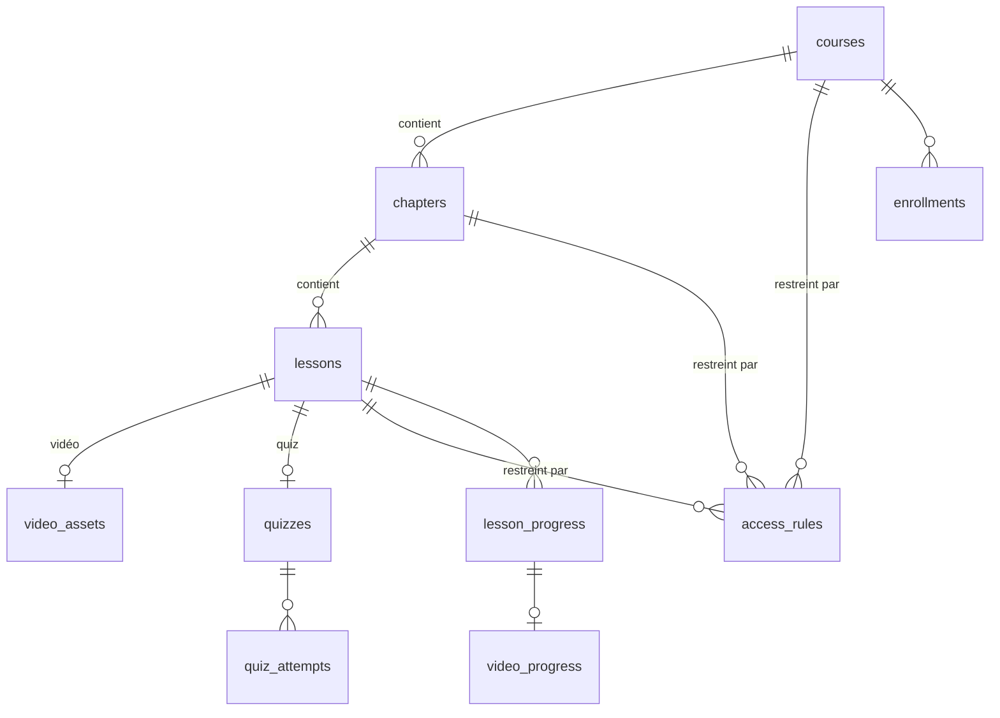

# 03 — Modèle de données

Toutes les tables vivent dans un **schéma PostgreSQL dédié**, `elearning` par défaut (configurable). Cela vaut que ce schéma soit dans la base du produit hôte ou dans une base dédiée (voir [04 — Intégration](04-integration.md#modes-de-données)).

## Conventions

- Clés primaires `uuid` (`gen_random_uuid()`).
- `created_at` / `updated_at` en `timestamptz` sur toutes les tables.
- **`tenant_id text null`** sur toutes les tables de contenu et de progression. Il sert aux produits hôtes multi-clients (un ERP qui sert plusieurs sociétés). Il reste `null` pour un hôte mono-tenant.
- **`learner_id text not null`** est l'identifiant opaque de l'utilisateur dans le produit hôte. Il n'y a **pas de clé étrangère** vers la table utilisateurs de l'hôte, ce qui permet d'utiliser une base dédiée. En mode base intégrée, l'hôte peut ajouter une FK s'il le souhaite.
- Les positions d'ordre (`position`) sont des entiers. Le réordonnancement se fait en une transaction.

## Schéma

### Contenu

**`courses`**

| Colonne | Type | Notes |
|---------|------|-------|
| id | uuid PK | |
| tenant_id | text null | |
| slug | text | unique par tenant |
| title | text | |
| summary | text null | |
| cover_image_url | text null | |
| status | enum `draft` \| `published` \| `archived` | |
| published_at | timestamptz null | |
| completion_rule | jsonb | ex. `{ "type": "all_required_lessons" }` |
| locale | text | `fr`, `en`… |
| metadata | jsonb | champ libre pour l'hôte |

**`chapters`** : `id`, `course_id` FK, `title`, `position`, `status`.

**`lessons`**

| Colonne | Type | Notes |
|---------|------|-------|
| id | uuid PK | |
| chapter_id | uuid FK | |
| type | enum `text` \| `video` \| `quiz` | |
| title | text | |
| position | int | |
| status | enum `draft` \| `published` | |
| is_required | bool | compte dans la complétion du cours (défaut `true`) |
| estimated_minutes | int null | |
| content | jsonb null | document Tiptap pour `text`, notes d'accompagnement pour `video` |
| settings | jsonb | ex. vidéo : `{ "completionThreshold": 0.95, "allowSeeking": false, "maxPlaybackRate": 2 }` |

**`video_assets`**

| Colonne | Type | Notes |
|---------|------|-------|
| id | uuid PK | |
| lesson_id | uuid FK unique | |
| provider | text | `cloudflare-stream`, `mux`, `bunny` |
| provider_asset_id | text | |
| status | enum `uploading` \| `processing` \| `ready` \| `error` | mis à jour par webhook |
| duration_seconds | numeric null | **source de vérité** pour la couverture, fournie par le fournisseur et jamais par le client |
| thumbnail_url | text null | |
| captions | jsonb | pistes de sous-titres `[{ lang, url }]` |

**`quizzes`**

| Colonne | Type | Notes |
|---------|------|-------|
| id | uuid PK | |
| lesson_id | uuid FK unique | |
| definition | jsonb | JSON SurveyJS **complet, bonnes réponses comprises**. Jamais envoyé tel quel au client. |
| passing_score | numeric | entre 0 et 1, ex. `0.8` |
| max_attempts | int null | `null` = illimité |
| cooldown_minutes | int | délai entre deux tentatives |
| shuffle_questions | bool | |
| show_correction | enum `never` \| `after_attempt` \| `after_pass` | |

### Accès

**`access_rules`** : voir [05 — Permissions](05-permissions.md).

| Colonne | Type | Notes |
|---------|------|-------|
| id | uuid PK | |
| tenant_id | text null | |
| target_type | enum `course` \| `chapter` \| `lesson` | |
| target_id | uuid | |
| effect | enum `allow` \| `deny` | |
| audience_type | enum `everyone` \| `role` \| `grade_min` \| `learner` | |
| audience_value | text null | nom de rôle, niveau de grade ou `learner_id` |

### Progression

**`enrollments`** : `id`, `tenant_id`, `course_id`, `learner_id`, `source` (`self` \| `assigned` \| `auto`), `assigned_by` null, `due_at` null, `started_at`, `completed_at` null, `progress` numeric (0–1, dénormalisé). Unique sur (`course_id`, `learner_id`).

**`lesson_progress`**

| Colonne | Type | Notes |
|---------|------|-------|
| id | uuid PK | |
| lesson_id | uuid FK | |
| learner_id | text | |
| status | enum `not_started` \| `in_progress` \| `completed` | |
| started_at / completed_at | timestamptz | |
| | | unique (`lesson_id`, `learner_id`) |

**`video_progress`**

| Colonne | Type | Notes |
|---------|------|-------|
| lesson_progress_id | uuid PK/FK | |
| watched_ranges | jsonb | intervalles fusionnés `[[0, 42.5], [60, 120]]` en secondes |
| watched_seconds | numeric | longueur de l'union, dénormalisée |
| coverage | numeric | `watched_seconds / duration_seconds` |
| last_position | numeric | pour reprendre la lecture |
| last_heartbeat_at | timestamptz | utilisé par le contrôle de plausibilité |
| suspicious_events | int | compteur des heartbeats rejetés |

**`quiz_attempts`** : `id`, `quiz_id`, `learner_id`, `started_at`, `submitted_at`, `answers` jsonb, `score` numeric, `passed` bool, `quiz_version` (hash de la définition au moment de la tentative).

### Technique

- **`schema_migrations`** : migrations appliquées (nom, checksum, date).
- **`event_outbox`** : événements à livrer au produit hôte (`id`, `type`, `payload`, `created_at`, `delivered_at`, `attempts`). Elle garantit qu'un événement n'est pas perdu si le hook de l'hôte échoue (pattern outbox).

## Règles de calcul

- **Leçon `text`** : `completed` quand l'apprenant clique sur « J'ai terminé » ou atteint la fin de la leçon. Option `requireScrollToEnd`.
- **Leçon `video`** : `completed` quand `coverage ≥ completionThreshold` (défaut 0,95).
- **Leçon `quiz`** : `completed` quand au moins une tentative a `passed = true`.
- **Progression d'un chapitre ou d'un cours** : nombre de leçons `is_required` et `completed` divisé par le nombre de leçons `is_required` **accessibles à l'apprenant**. Les leçons auxquelles il n'a pas accès ne le pénalisent pas.
- `enrollments.progress` et `completed_at` sont recalculés dans la même transaction que tout changement de `lesson_progress`.

## Publication et évolution des contenus

- Les apprenants ne voient que les contenus `published` dont tous les parents sont `published`.
- Modifier une leçon publiée ne réinitialise **pas** la progression existante.
- Une tentative de quiz garde le `quiz_version` utilisé : un quiz modifié après coup ne change pas un score historique.
- Le versionnage complet des contenus (historique des révisions) est hors v1.
