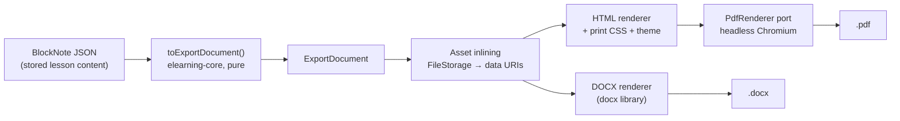

# 10 — Editor extensions: multi-column layout, PDF and Word export

BlockNote's core packages (MPL-2.0) cover the Notion-like editing experience. Three features we need are only available in BlockNote's `@blocknote/xl-*` packages, which are licensed **GPL-3.0 or commercial**:

- multi-column layouts;
- PDF export;
- Word (`.docx`) export.

Neither license works for an MIT module embedded in proprietary products:

- **GPL-3.0** would force every host product to be distributed under the GPL.
- A **commercial license** would cover BeBranded, but not the other people and companies who install our MIT packages. They would each need their own license.

We therefore build these three features **ourselves, from scratch, under MIT**, following the clean-room rules below.

## Clean-room rules

Reading GPL code and rewriting it produces a derivative work, which would still be GPL. To stay legally clean:

1. **Nobody working on these features reads the source code of `@blocknote/xl-*`** or of any other GPL, AGPL or commercial implementation of the same features. This includes "just for inspiration" reading and asking an AI assistant to summarize or translate that code.
2. **Allowed inputs**:
   - this specification;
   - BlockNote's public documentation and the public API of its MPL-2.0 core packages;
   - observable end-user behavior, for example using a public demo as a user;
   - open format specifications (ECMA-376 / Office Open XML, CSS Paged Media);
   - documentation and source code of the permissively licensed libraries listed below.
3. **The behavior is specified first** (this document), then implemented against the specification.
4. **Traceability**: the pull request template includes a checkbox stating that the author has not consulted GPL or commercial implementations of the feature.
5. **Our own data format**: the JSON shape of our column blocks is designed by us. Compatibility with documents produced by `@blocknote/xl-multi-column` is a non-goal.

## Technology selection

| Need | Choice | License | Why | Rejected alternatives |
|------|--------|---------|-----|-----------------------|
| Editing model for columns | **BlockNote's layout block API** (`layoutOnly`, `children`, `placeable`, `renderFrame`) in its MPL-2.0 core, with our own block specs ([ADR-0001](../adr/0001-multi-column-layout-blocks.md)) | MPL-2.0 (BlockNote core, unmodified) | Nested blocks, drag & drop, cursor movement, undo and schema enforcement come from the editor; no GPL code involved | Our own ProseMirror node specs (rebuilds what the core ships, high risk); simple custom block with a fixed layout (no nested blocks, poor UX) |
| Shared export format | **Our own intermediate document tree** (`ExportDocument`) in `elearning-core` | MIT (ours) | One conversion from BlockNote JSON, then one renderer per format. Each renderer is tested on the same fixtures. | Converting BlockNote JSON separately for each format |
| HTML (learner view and PDF source) | Our own renderer (`renderLessonHtml`), then `sanitize-html` | MIT | Reuses the server-side rendering already used for lessons (see [02 — Architecture](02-architecture.md#reading-a-text-lesson), D11) | `@blocknote/server-util`: needs jsdom and React, fails on toggle blocks under Node, no edge support |
| PDF | **HTML + print CSS rendered by headless Chromium**, behind a `PdfRenderer` port | — | Highest fidelity (tables, columns, fonts, images), reuses the HTML renderer and the theme, and gives a PDF with real selectable text | `@react-pdf/renderer` (MIT): every block would need a second layout implementation with a limited CSS subset. `pdf-lib`: too low-level. |
| PDF adapters | `playwright-core` (Node / self-hosted), `puppeteer-core` + `@sparticuz/chromium` (Vercel and other serverless platforms), `@cloudflare/puppeteer` (Cloudflare Browser Rendering), HTTP client for **Gotenberg** (container) | Apache-2.0 / MIT | Each host picks what its infrastructure supports | Bundling Chromium in our packages |
| Word | **`docx`** (builds `.docx` files from a typed API) | MIT | Mature, actively maintained, typed, covers headings, lists, tables, images, styles and numbering | Converting HTML to DOCX (poor fidelity), generating raw OOXML by hand |
| Zip (dependency of `docx`) | `jszip` | MIT **or** GPL-3.0 (dual) | We use it under the **MIT** option. The license check allowlists it explicitly with that choice. | — |

All new dependencies must pass the CI license check (see [08 — Licensing](08-non-functional-requirements.md#licensing)).

## Package layout

```
packages/
├── core/
│   └── src/export/          ExportDocument types, BlockNote JSON → ExportDocument (pure)
├── editor/
│   ├── src/blocks/          columns.ts (columnList + column specs, resize handle), column-widths.ts
│   └── src/render/html/     ExportDocument → HTML (learner view, PDF source)
└── export/                  @bebranded/elearning-export (new, server-only)
    ├── src/pdf/             PdfRenderer port + adapters (playwright, serverless, cloudflare, gotenberg)
    ├── src/docx/            ExportDocument → .docx with the `docx` library
    └── src/assets/          image inlining through FileStorage
```

`elearning-export` is a separate, server-only package. Hosts that do not need export never install Chromium-related dependencies.

## Multi-column layout

### Data model

Two block types in the lesson editor's schema (quiz lessons have no columns):

```json
{
  "id": "…",
  "type": "columnList",
  "props": {},
  "children": [
    { "type": "column", "props": { "width": 0.6 }, "children": [ /* any blocks except columnList */ ] },
    { "type": "column", "props": { "width": 0.4 }, "children": [ /* … */ ] }
  ]
}
```

- A `columnList` holds **2 to 4** `column` blocks.
- `width` values are positive ratios, normalized to sum to 1 when rendered. Each column takes at least **0.15** of the row once normalized. New columns start at `1`; resizing stores normalized shares.
- A `column` contains any regular block, but **no nested `columnList`** at any depth, to keep layouts readable and exports predictable. A `column` outside a `columnList` is invalid.
- Server-side content validation enforces these constraints (`invalid_content`, and `nested_columns` for a list inside a list). The editor's schema enforces the same rules while editing.

### Editing behavior

| Action | Behavior |
|--------|----------|
| Create columns | Slash menu entries "2 columns", "3 columns", "4 columns" (group "Layout"): equal columns, each starting with an empty paragraph that takes the cursor. An empty paragraph is replaced; otherwise the columns go after the current block. Creating columns by dragging a block onto another block's edge is planned (BACKLOG). |
| Drag between columns | BlockNote's drag handle moves blocks within a column, between columns, and out of the column list. |
| Resize | A handle (`role="separator"`, named in the editor's language: `createLessonEditorSchema({ columnResizeLabel })`, English by default) on the right edge of every column but the last moves width between that column and the next one, in steps of 5% of the row, never below 15%. Drag it, or focus it and use the left and right arrow keys. |
| Remove a column | A column whose last block is removed is removed. When only one column remains, the column list dissolves and its blocks go back to the main flow. |
| Keyboard | BlockNote's cursor movement crosses column boundaries in document order (left column top to bottom, then the next column). |
| Undo / redo | Every operation above is a single history step; a resize is one step. |

### Rendering

- Each column's share is rounded to a **5% step** (15 to 100) and written as `data-width`. Stylesheets map the steps to flex ratios, so lesson pages and exports need no inline style (strict CSP).
- On the learner page (`columns.css`, imported by `styles.css`), a column never gets narrower than 14rem: on narrow screens the columns **wrap and stack** in order, with no breakpoint to configure.
- Screen readers read columns in document order. The layout carries no semantics.

### Risk

Multi-column editing was the hardest piece of this document: nested containers in ProseMirror, drop zones, cursor behavior. It started with a **time-boxed spike** (see [09 — Roadmap](09-roadmap.md)). The spike found BlockNote's layout block API and answered **go**: the full behavior, not the fallback (a simpler layout block, columns editable one at a time). See [ADR-0001](../adr/0001-multi-column-layout-blocks.md). Every BlockNote upgrade reruns the column tests, since the API is recent.

## Export

### What can be exported

| Scope | Route | Notes |
|-------|-------|-------|
| One lesson | `GET /lessons/:id/export?format=pdf\|docx` | Text lessons and notes of video and quiz lessons |
| A whole course | `GET /courses/:id/export?format=pdf\|docx` | Cover page, generated table of contents, chapters as sections |

- The host passes `exporter: elearningExport({ pdf })` to `createElearning`, and optionally `exportLessonUrl({ courseId, courseSlug, lessonId })` for the links back to its lesson pages (the site root otherwise) and `exportsPerTenant` (2 at once by default, then 429 `export_busy`). Without `exporter`, the routes answer 409 `export_not_configured` and course pages list no format.
- The course page (`GET /v1/courses/:slug`), the lesson (`GET /v1/lessons/:id`) and the admin course tree (`GET /v1/admin/courses/:id`) answer `export_formats`: the formats this requester may use, empty when export is off for them.
- **Download buttons**: `<ExportActions>` (`@bebranded/elearning-react`) renders one button per offered format in the course page header, the lesson page header, and the back-office course and lesson pages (drafts included), and nothing when `export_formats` is empty. It downloads through the host's `fetcher`, saves the file under the server's name, announces "Preparing your file…" while the server works, and explains `export_busy` and `export_too_large`. The back-office course settings have the "Learners can download this course" checkbox (`allow_learner_export`).
- `?format=` is `pdf` or `docx` (400 otherwise; 400 `export_format_unavailable` for a format the exporter lacks). The file is an attachment, never cached.
- **Access rules apply**: an export only contains content the requester can access. A course export skips inaccessible lessons, as the course page does.
- **Admins** can export drafts. Learners only export published content.
- Course-level settings let admins enable export for learners (`allow_learner_export`, default `false`); otherwise learners get 403 `export_not_allowed`.
- Images are read through the host's `FileStorage.read`; without it, exports carry no pictures.

### Pipeline



### The `ExportDocument` tree

`toExportBlocks` (elearning-core, pure) converts a validated lesson document. `buildLessonExport` and `buildCourseExport` wrap the blocks in sections: a lesson export has one section (depth 1); a course export has each chapter (depth 1, no blocks) followed by its lessons (depth 2), with the course summary as subtitle and a cover page and table of contents. Rules of the conversion:

- consecutive list items of one type form one list (numbered lists keep their start, check items their state);
- toggles are expanded: the heading or line, then its children as an indented group; children of a paragraph or quote are an indented group too;
- table cells in the header rows or header columns are header cells; spans are kept;
- images and files point to their uploaded file id; a media block whose upload never finished is left out; an image without preview is exported as an attachment;
- a video lesson's section starts with the video's title and a link to the lesson; quiz questions are never in the tree, only the lesson's notes;
- `walkExport` visits every block iteratively, `exportImageIds` lists the images to inline once each, and `countExportBlocks` measures the document against `EXPORT_LIMITS` (20,000 blocks, 200 images, 25 MB of images) before any rendering.

### HTML for PDF

`renderExportHtml` (`@bebranded/elearning-editor/server`) turns an `ExportDocument` into one self-contained HTML document:

- the head is fixed: charset, title, and print CSS (`@page` A4 or Letter, page breaks before chapters, header rows in `thead` so they repeat). The theme's primary color must be a `#rrggbb` value and its font family a plain list of names; anything else falls back to the defaults, so a theme value cannot inject CSS;
- a lesson starts with its title and course; a course with a cover page (optional logo), a table of contents linking to each section, then chapters (`h2`) and lessons (`h3`) with content headings shifted below them;
- images are `` only with an inlined `data:image/(png|jpeg|gif|webp);base64` source. An image that could not be inlined becomes an attachment line linking to the lesson; any other source is dropped by the sanitizer;
- the body goes through an allowlist sanitizer: no script, no event attribute, no `javascript:` link.

### Export package

`@bebranded/elearning-export` exposes `elearningExport(options)`, the `DocumentExporter` port of elearning-core that the server receives. It:

1. refuses a document over `EXPORT_LIMITS` (20,000 blocks), then reads every image through the host's `FileStorage.read` (at most 200 images and 25 MB in all) and keeps only real PNG, JPEG, GIF and WebP pictures, recognized from their bytes, never from a declared type;
2. renders Word with `docx`, or the HTML of `renderExportHtml` through a `PdfRenderer`;
3. bounds the work: a 30 s deadline (`export_timeout`, 502), 2 renders at once and 8 waiting, then `export_busy` (429).

PDF adapters receive the host's own browser library through a small structural interface, so the package bundles no browser and depends on none: `playwrightPdf` (playwright-core), `puppeteerPdf` (puppeteer-core with @sparticuz/chromium, or @cloudflare/puppeteer) and `gotenbergPdf` (HTTP). Playwright opens a context with JavaScript disabled, offline, and every route aborted; Puppeteer disables JavaScript and aborts every request except inlined `data:` pictures. Headers carry the title and footers the export date and page numbers. Word: Title and Heading styles (navigation pane, and a table of contents field in course exports), Word numbering with one instance per numbered list, repeated table header rows, callouts as one shaded cell with a colored border, the module's own Quote and Code styles; Word cannot embed WebP, so those images become a link to the lesson.

### Block mapping

| Block | PDF (HTML + print CSS) | Word |
|-------|------------------------|------|
| Headings | `h1`–`h3`, PDF bookmarks | Heading 1–3 styles (Word navigation pane) |
| Paragraph and inline styles | Native | Runs with bold, italic, underline, strike, code, color, links |
| Bulleted, numbered and check lists | Native lists | Word numbering definitions, ☐ / ☑ for check lists |
| Toggle | Expanded | Expanded |
| Quote | Styled `blockquote` | "Quote" style |
| Callout | Tinted box with icon | Single-cell shaded table |
| Code | Monospace block, no syntax highlighting in v1 | Monospace style, shaded paragraph |
| Table | Native table, header row repeated across pages | Word table, repeated header row |
| Image | Inlined image with caption | Embedded image scaled to page width, caption |
| Columns | CSS grid, kept on one page when possible | Borderless table, one cell per column with the matching width. Word section columns flow text and would not match the layout. |
| Video | Thumbnail + title + link to the lesson | Same |
| Quiz questions | **Excluded by default.** Optional "questions only" mode, never with answers for learners | Same |
| File attachment | Name + link to the lesson | Same |

### Document styling

- Exports use the host theme (primary color, font family) and an optional logo, so a document matches the host product's branding.
- Page format A4 or US Letter, set by the host or from the requester's locale.
- Header with course and lesson title, footer with page numbers and export date.

## Export security

The PDF renderer runs a browser on the server. It must never become a way to read internal resources (SSRF) or to run code.

- Chromium only renders **HTML that we generate and sanitize**. It never receives user-provided HTML or an arbitrary URL.
- **JavaScript is disabled** in the rendering page.
- **All network requests from the page are blocked.** Images are fetched beforehand, server-side, **only through the `FileStorage` port**, and inlined as data URIs. Editor images must therefore be uploaded files. External image URLs are rejected at content validation time.
- Fonts are bundled or inlined. Nothing is fetched at render time.
- Limits: maximum document size (number of blocks, total image weight), rendering timeout (default 30 s), concurrency limit per tenant, and the `rateLimit` hook on export routes.
- Exports are generated on request and streamed to the requester. They are not stored, unless the host decides to cache them in its own storage.
- Word files are generated from structured data by the `docx` library. No user content is interpreted as XML.

## Testing

- **Golden fixtures**: a set of BlockNote documents covering every block type, rendered to `ExportDocument`, HTML, PDF and DOCX.
- PDF: text extracted from the output is compared with the expected text. **Layout checks** read sizes and positions back from real Chromium PDFs with pdfjs: lesson headings print larger than body text in level order, columns sit side by side with their share of the row, every line stays inside the page, every page is numbered. They replace pixel snapshots, which depend on the fonts of each operating system.
- DOCX: the generated XML is checked for expected styles and structure. In CI, each fixture `.docx` (lesson, course, columns) is converted by headless LibreOffice and its text checked (`pnpm --filter @bebranded/elearning-export validate:docx`).
- Columns: editor tests on a mounted editor (structure, resize by keys and by dragging, undo, dissolving, nesting refused) and Playwright scenarios for every behavior in the editing table, on desktop and mobile widths (planned with the demo journeys, BACKLOG).
- Security tests: a document with an external image URL, `javascript:` links, oversized content and hostile text must be rejected or neutralized, and the renderer must not make any network request (verified by request interception).

## Out of scope

- AI writing features.
- Exporting to formats other than PDF and DOCX (ODT, Markdown, EPUB).
- Importing DOCX or PDF files into the editor.
- Syntax highlighting in exports.
